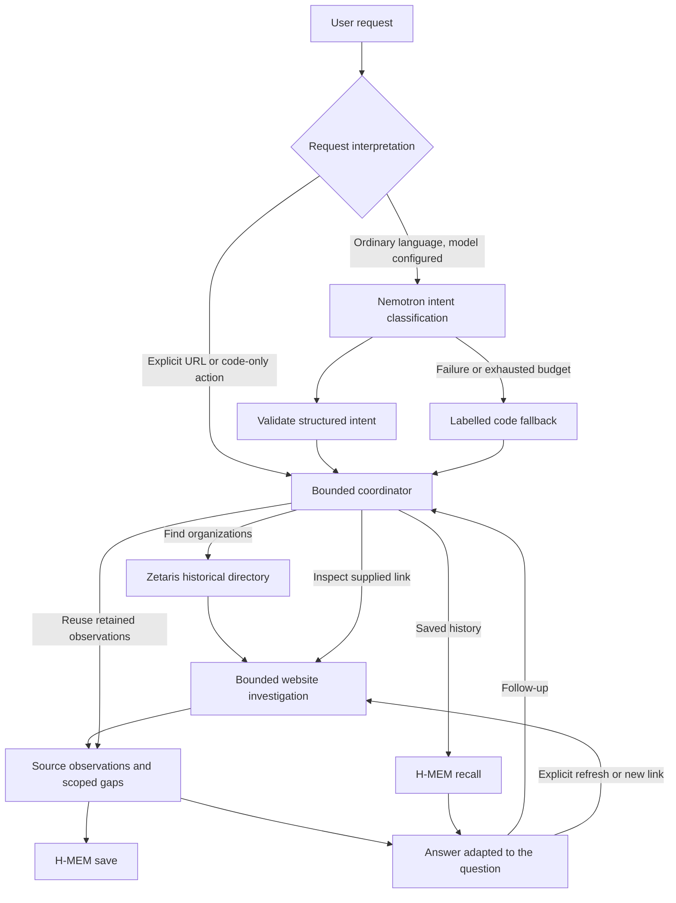

# Purrpose

**Before you give, see the evidence.**

Purrpose helps donors explore animal-rescue appeals, understand the public evidence behind claims, and see what still needs verification. Rescue organizations use the same evidence system to learn what public information they could add. Organizations of all sizes should have a fair chance to be seen.

A locally hosted Open Agent Hackathon 2026 prototype, initially for Ontario, Canada. No payments, fraud verdicts or guaranteed trust certification.

## What works

- Natural-language request handling, with optional live NVIDIA Nemotron intent classification and a code fallback.
- Historical government directory queries through AWS-hosted Zetaris, returning organizations with full names, reported cities and sources.
- Bounded reading of public organization websites and explicitly supplied appeals, including access checks and source-linked observations.
- One shared evidence checklist: donors see available material and uncertainties; organizations see information to publish or clarify.
- Actual observation save/recall through the official Meterless H-MEM reference engine.
- Agent map and Runs views showing actual executed roles, tool outcomes, timing and model usage.

The real Lucy appeal stays pending verification. Maple is explicitly fictional and demonstrates a capped review/repair loop. Neither silently replaces live website results.

## Quick start

Python 3.12+. Node.js 24+ for H-MEM. Hosted NVIDIA and local H-MEM do not require a dedicated GPU.

```powershell
git clone https://github.com/sjd1ka/human-being-hackathon-2026.git
cd human-being-hackathon-2026
python -m venv .venv
.\.venv\Scripts\python.exe -m pip install -r requirements.txt
.\.venv\Scripts\python.exe -m purrpose.server --port 8767
```

Open [home](http://127.0.0.1:8767/home.html) or [chat](http://127.0.0.1:8767/app.html).

**This minimal launch does not connect NVIDIA, H-MEM or Zetaris.** It supports UI exploration and labelled examples. Public URL reads require internet access. Follow [Setup](docs/SETUP.md) to reproduce the integrated demo.

## Required connections for the integrated demo

| Component | Actual role | What you need |
|---|---|---|
| NVIDIA Nemotron direct API | Classifies the request; does not authenticate evidence | Your API key, model access and explicit request/token caps |
| Zetaris Lightning | Fixed read-only SQL over the public CRA 2024 directory | An authorized running instance, JDBC credentials, vendor driver JAR, Java/JVM and the configured tables |
| AWS | Hosts the team's Zetaris instance | Permission and network access to that instance; the app needs no AWS access keys and creates no AWS resources |
| Meterless H-MEM | Saves and recalls scoped observations and open questions | Node 24+, official engine source, writable local state folder |
| Public websites and government APIs | Source material | Internet access and permitted automated access |
| Meterless Nightshift | Optional alternative model route, implemented but not live-verified here | A separately running compatible runtime and token; direct NVIDIA does not count as Nightshift use |

Credentials, credits, cloud instances, driver binaries and local memories are not included. Each operator supplies their own authorized configuration. [Setup](docs/SETUP.md) provides Windows commands and a clean configuration example.

## Workflow



Roles execute as code in one process, not four or six obligatory LLM calls. The curated Lucy review additionally supports conditional chronology resolution; the fictional Maple review has a capped repair loop. Arbitrary website reads currently provide basic observations and gaps, not independent deep evidence evaluation or general dispute resolution. See [Architecture](docs/ARCHITECTURE.md).

## Try it

1. Ask: `I would like to support a cat rescue around Toronto. Could you help me find options?`
2. Select a returned organization by full name. Failed access does not imply wrongdoing.
3. Supply a public appeal URL to investigate a specific case. Automatic current medical-appeal discovery for every organization is not established.
4. Ask what evidence is missing or how much is still needed. Unknown funding remains unknown.
5. Ask `show website history`. This recalls the current directory investigation or selected website's scoped records.
6. Open **See how this was worked out** or **Runs** for actual tool use.

[Demo guide](docs/DEMO.md) includes the real Lucy URLs, an organization example and recording steps. External content and availability can change.

## Limits and next steps

- CRA 2024 data is historical, not current registration or risk clearance. Office city is not treatment location. Cat-name matching misses organizations without cat-related names.
- Published claims and medical keywords are not authenticated clinical evidence. Costs, funds received, current need, recipient linkage and risk can remain unverified.
- Public HTTPS text only: no login/CAPTCHA bypass, social-media scraping, private uploads, media analysis or payments. Source restrictions stop the read.
- Short robots delays can be honored for one supplied page. No automatic retries or hidden provider substitution.
- H-MEM persists locally. Chat sessions and the last 50 runs reset on restart. Model budgets are process-local too; do not restart to bypass an agreed allowance.
- Nightshift is unconnected in the verified environment. The operator reported permission to skip it; retain that confirmation and check organizer requirements before claiming compliance.
- Future: deeper evidence evaluation, automatic appeal discovery, broader conversational coverage and user testing. No model training is performed in this prototype.

## Validation

```powershell
.\.venv\Scripts\python.exe -m unittest discover -s purrpose -t . -q
node purrpose/test_api_client.cjs
node purrpose/test_agent_map.cjs
node purrpose/test_review_panel.cjs
node purrpose/test_live_panels.cjs
```

H-MEM integration tests skip without the official reference configured. [Validation](docs/VALIDATION.md) distinguishes automated tests from live evidence.

## Project files

| Path | Contents |
|---|---|
| `purrpose/` | Application, tests, research notes and labelled fixtures |
| `docs/SETUP.md` | Dependencies, account access, connection steps and launch commands |
| `docs/ARCHITECTURE.md` | Roles, shared evidence and actual routing boundaries |
| `docs/DEMO.md` | Recording walkthrough |
| `docs/specification/` | Full product requirements and future acceptance scope, beyond this prototype |
| `design/` | Logo/design assets; `design/home/` is a standalone design preview |
| `scripts/start_demo.ps1` | Portable Windows launcher |

Built by Shiyuan Tian, Benedictus Josh Christian, Farwa Yaqub and Pimmy (Pimlada Cbys).
